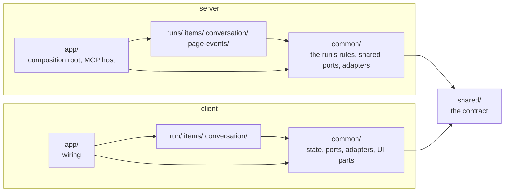

# Workbench conventions

How workbench is built, and the rules a change to it follows. What a machine can
check, `pnpm run check` checks; the rest is for whoever writes and reviews the change.
How tests are written is in [`testing.md`](testing.md).

## Principles

- **Anything critical is enforced by the server, never by instructions alone.** Approve
  is refused while questions are open; a verdict counts only against the revision on
  screen; a run can't close until every item has an outcome; the Stop hook blocks a turn
  that ends with nobody listening. A skill's instructions can be misread; the server can't.
- **The page only shows what the tools put in the run, and only sends the user's
  events.** It creates no content of its own.
- **Nothing the user does is lost.** Every page event is written to the run's log before
  it is applied, and handed to Claude exactly once.
- **One fixed format: the hello proof.** The page proves the server holds the run's token
  with `HMAC(token, "workbench-hello|<nonce>|<port>|<build>")`. Old pages must be able to
  verify new servers, so this string never changes.

## Architecture: modules by area, each in layers

The server and the page are both organised like Mi Plan v2's backend: a `common/` that
every module shares, one module per area of the product, and an `app/` that wires them.
Inside each, the same four layers.

Inside a module (and inside `common/`):

| Layer             | Holds                                                                                                 | May import                                |
| ----------------- | ----------------------------------------------------------------------------------------------------- | ----------------------------------------- |
| `domain/`         | rules as pure functions over plain data (`*.rules.ts`), and the module's own ports                    | `shared/`, `common/domain`                |
| `application/`    | use cases: one class per file (`*.use-case.ts`), with only `execute`; mappers (`mappers/*.mapper.ts`) | `domain/`, ports, `common/application`    |
| `infrastructure/` | what implements the ports: disk, HTTP, processes, the browser                                         | `domain/`, ports, `common/infrastructure` |
| `interface/`      | how the outside reaches the use cases: MCP tools and the Stop hook; page views                        | `application/`, `domain/`                 |
| `__tests__/`      | `unit/` and `integration/`, as in Mi Plan                                                             | anything                                  |

Each server module has a `<area>.module.ts` that builds its use cases with `new`, from
the adapters it is given (`runsModule`, `itemsModule`…); `server/app/modules.ts` builds
them all from one set of adapters, and the use-case tests build them from fakes the same
way. The page does the same in `client/app/modules.ts`. There is no container and no
string token: a constructor parameter's type is the port it needs.

| Folder                 | Holds                                                                                                                                                                                                                                                                                    |
| ---------------------- | ---------------------------------------------------------------------------------------------------------------------------------------------------------------------------------------------------------------------------------------------------------------------------------------- |
| `shared/`              | the contract both halves use: schemas, types, fixed values. Imports nothing of ours                                                                                                                                                                                                      |
| `server/common/`       | the run's rules (`domain/run.rules.ts`, `item.rules.ts`, `conversation.rules.ts`, `page-event.rules.ts`), the ports two or more modules use (`ports/*.port.ts`), `RunChanges` (load, change, save, show under the run's lock), their adapters, the HTTP app, and what every tool returns |
| `server/runs/`         | opening, resuming, listing, the status line, closing; the live index; the Stop hook                                                                                                                                                                                                      |
| `server/items/`        | adding, updating, asking about and marking items done                                                                                                                                                                                                                                    |
| `server/conversation/` | Claude's messages and the diagrams they embed (with the Mermaid writer)                                                                                                                                                                                                                  |
| `server/page-events/`  | the mailbox: recording what the page sends, taking and waiting for it; images                                                                                                                                                                                                            |
| `server/app/`          | the composition root (`Workbench`), the MCP host the tools run in, `main.ts`                                                                                                                                                                                                             |
| `client/common/`       | the page's state and selectors, its ports, the server and browser adapters, the shared UI parts and styles, sending a page event, following the session                                                                                                                                  |
| `client/run/`          | progress, the connection banner, the tab, the other open reviews                                                                                                                                                                                                                         |
| `client/items/`        | the item panel, questions, the verdict, and one view per item kind (`interface/kinds/`)                                                                                                                                                                                                  |
| `client/conversation/` | threads, attachments, quoting an item into its conversation; loading images                                                                                                                                                                                                              |
| `client/app/`          | the page shell, its hooks, and the wiring                                                                                                                                                                                                                                                |

These rules are enforced by `config/dependency-cruiser.cjs` in `pnpm run check`:

- **Modules are independent.** No module imports another; what two need lives in
  `common/`. `common/` imports no module, and nothing but `app/` imports `app/`.
- **The domain is pure.** `domain/` and `ports/` import no use case, adapter, view or Node
  built-in.
- **Use cases reach the outside only through ports.** `application/` imports no
  `infrastructure/` or `interface/`, and on the server no Node built-in.
- **Views reach the outside only through what the app hands them.** On the page,
  `interface/` imports no `infrastructure/`: a view gets a port (the draft store) or a use
  case (shrinking images, loading one) as a prop, and `client/app/main.tsx` builds the
  browser's adapters.

**Why plain TypeScript and not NestJS.** Nest would give the same structure with
decorators, but its injection reads decorator metadata esbuild can't emit, and Nest,
reflect-metadata and rxjs would load at every session start. Hand wiring in a module file
keeps the bundle one file Node starts in a fraction of a second.

**Why dependency-cruiser.** For about a hundred modules a framework (Nx) would be far
more machinery than the rules it brings. The alternatives:

- TypeScript project references can keep layers apart, but they need one `tsconfig` per
  module to say "modules don't import each other".
- `eslint-plugin-boundaries` would show violations in the editor. It would take every rule
  rewritten in its terms, and it doesn't find cycles.

dependency-cruiser states each rule as data, with its reason. It also finds cycles,
resolves the path aliases through `tsconfig.json`, and fails the check if it read too few
modules to mean anything. Revisit this if the editor feedback starts to matter more than
one tool fewer.

### Use cases and ports

- **A use case is a class with one public method, `execute(input)`.** Its constructor
  takes the ports it needs, as `private readonly` parameters, and nothing else. It calls
  the domain's pure functions; it doesn't hold rules of its own beyond the order of steps.
- **A port is an abstract class**, one per file, named `<name>.port.ts`. An adapter
  `implements` it (`class FsRunStore implements RunStore`), so the compiler checks the
  contract, and a test's fake does the same.
- **The run is plain data.** It is saved as it is and sent to the page as it is, so the
  rules stay functions like `applyVerdict(run, …)`, never methods on an entity class.
  They live in `domain/*.rules.ts`, one file per thing they govern: the run's life, items,
  the conversation, page events. The ones Claude's tools and the user's page events both
  use (items, messages) are in `common/domain`, since modules can't import each other.
- **A use case returns the domain's data, and a mapper shapes it for its caller**, as Mi
  Plan's mappers do for its controllers. `ItemMapper.toAdded(items)` turns the added items
  into what `add_items` returns; `PageEventMapper.toDelivered(taken)` turns logged events
  into what Claude reads. A change in what a use case returns is absorbed in its mapper, so
  the tool's result, which skills read, stays the same. Mappers are classes of static
  methods in `application/mappers/<area>.mapper.ts`, with a named `…Response` type per
  result. On the page, `PageEventMapper.toNotice(outcome, …)` turns how sending went into
  what the user is told.

### Where ports live

A port is part of the contract of the code that needs it, not of the code that implements
it, so where it lives follows who uses it:

- **Used by one module:** in that module, under `domain/ports/`
  (`server/runs/domain/ports/live-index.port.ts`). Reading the module tells you everything
  it needs from outside, and deleting the module deletes its port. It declares only what
  the module calls: `LiveIndex` has `alive()`, though the adapter also writes.
- **Used by two or more modules:** in `common/ports/`. It has to move there: modules may
  not import each other, so neither can own it.
- **What a module's interface needs from the app** is a port too, in that module's
  `interface/` (`ToolHost` in `common/interface/mcp`, `RunPages` for `open_session`,
  `WaitHost` for `wait_for_events`); `server/app/tools.ts` implements them.
- **Used by nothing but the app:** it isn't a port. It stays a plain method on the
  composition root (the page address, `Workbench.pageUrl`).

The errors a port can fail with live beside it.

### Adding to it

- **A tool:** a use case in the module it belongs to
  (`<module>/application/use-cases/<name>.use-case.ts`), added to `<module>.module.ts`,
  registered in `<module>/interface/mcp/<module>.tools.ts`, with its tests in
  `<module>/__tests__/unit/`. A tool for a new area is a new module, added to
  `server/app/modules.ts` and `server/app/tools.ts`.
- **A kind of item** (pr-review findings, review-queue pull requests): its schema in
  `shared/contract.ts` added to `ItemKinds`, its view in
  `client/items/interface/kinds/<kind>/` added to `kinds/index.ts`. The tools stay the same.
- **A tool's result:** a `…Response` type and a method on the module's mapper; the tool
  calls `Mapper.toX(await useCase.execute(input))`.
- **A part of the page:** a view in the module it belongs to, under `interface/`, wired in
  `client/app/`. If it needs the server or the browser, it gets a use case, built in
  `client/app/modules.ts`, as a prop.
- **Something the page needs from outside** (storage, the network, the canvas): an abstract
  class in the `domain/ports/` of the module that uses it (`common/ports/` if several do),
  and a class in that module's `infrastructure/` that `implements` it, built in
  `client/app/main.tsx`.

## Code style

Formatting is Prettier's (settings under `"prettier"` in `package.json`, 120 columns):
run `pnpm run format`. ESLint (`config/eslint.config.mjs`) enforces what a machine can
see, marked _(lint)_ below. Both run in `pnpm run check`. The rest is for review.

### Reading order

- **Code should explain itself.** A name that says what a thing is beats a comment that
  explains a short one. Comments say _why_, never _what_, and only where the code can't
  say it.
- **The explanation of what a file is for sits on its main export**, as JSDoc right
  above the class, function or component, so an editor shows it on hover. A file with no
  single main export (a `*.rules.ts` of several rules, the contract, a test suite) opens
  with one line on what it is for instead.
- **Constants come first**, right after the imports: values, then the tables built from
  them, then module state (caches). A type derived from a constant sits right below it.
  A function is a `function`, not a `const` arrow, so it never reads as a constant.
- **Then the file reads top-down by importance.** What it exports and exists for comes
  first; the helpers it uses come below, in the order they are needed.
- **A condition that needs a moment to read gets a name**:
  `const verdictJustLanded = previous !== status;` then `if (verdictJustLanded)`.

### Names and values

- **No single-letter names** _(lint)_. `_` marks a parameter that is deliberately unused.
  Names come from the domain: `item`, `verdict`, `itemIndex`, never `cur` or `x`.
- **No shadowing** _(lint)_: an inner name never hides an outer one.
- **Fixed sets of values are constants, never bare strings.** Compare against
  `VERDICT.approved`, `RUN_STATUS.open`, `CONNECTION.live`, and derive the type from the
  constant. They live with what they describe:
  - `shared/values.ts` for the run's own values (it imports nothing, so the page can use it
    without loading zod);
  - `client/common/domain/connection.ts` for connection kinds, `client/common/domain/state.ts`
    for actions;
  - `client/common/domain/selectors.ts` for turn views;
  - `client/common/interface/ui/classes.ts` for CSS classes.
- **A constant other code needs is exported from where it is defined, once.** The
  stream's event names (`STREAM_EVENT` in `shared/constants.ts`) are used by the server
  and the page; the favicon colours (`TURN_COLOR`) by the page and the browser tests.
- **Numbers that mean something get a name** that says why they are that value:
  `ACTIVE_FOR_MS`, `FIRST_ITEM`, `ADVANCE_MS`. In tests, derive them from the product's
  constant when there is one (`PAST_ACTIVE_WINDOW_MS = ACTIVE_FOR_MS + 1_000`).
- **CSS classes are built with `classes()`**, not template strings:
  `classes('iconbtn', open && CLASS.on)`.
- **An object type with two or more fields gets a name**: a component's props are
  `interface <Component>Props`, a function's options are an interface too. Each field on
  its line, with a comment where its meaning isn't obvious.

### Control flow

- **A guard clause's body goes on its own line** _(lint: `curly`)_:
  `if (!item) {` / `return;` / `}`, never `if (!item) return;`.
- **A `switch` over a fixed set of values, not a chain of `if`s**, building the result
  and returning once at the end. One exit makes a function predictable; early returns
  stay for guard clauses at the top.
- **A ternary is for a short either-or** _(lint: no nested ternaries)_. Anything longer
  is an `if`/`else`, a lookup table, or a small function.
- **No inline casts** _(lint: no `x as T`; `as const` stays)_. Types come from:
  - declarations where data enters: `const event: RecordedEvent = JSON.parse(line);`
  - type guards: `error instanceof Error`, `isErrno(error, 'ENOENT')`, `isRecord(value)`;
  - parsers for what can't be trusted: zod for tool results in tests;
  - better-typed APIs: `event.currentTarget` in a handler, a const tuple for a zod enum.
- **A method passed as a callback is bound** _(lint: `unbound-method`)_:
  `load={() => listOpenReviews.execute()}`, never `load={listOpenReviews.execute}`, which
  loses `this`.
- **Errors are classes in their own file, next to the contract they belong to**
  (`server/common/domain/errors.ts`, `client/common/domain/errors.ts` beside the page's
  ports), so
  callers can tell them apart with `instanceof` without knowing which adapter threw.
- **Components render; behaviour lives elsewhere.** Use cases do what reaches the server
  (sending a page event, following the session); hooks in `client/app/hooks.ts` hold the
  shell's stateful behaviour (navigation, unread); pure functions in
  `client/common/domain/selectors.ts` derive what to show. A component reads them and draws.
- **Imports use the path aliases** `@shared/`, `@server/`, `@client/` and `@test/`
  (defined once, in `tsconfig.json`). `./` is only for a file in the same folder; never `../`.
- **Messages the user reads are written once**, as named constants next to where they
  are shown (`SENT` in `client/app/App.tsx`).

## Security

- The run's token lives in `run.json`, in a folder only its user can read. No tool ever
  returns it. The page receives it in the address fragment (never sent to a server) and
  sends it only in a header, and only after the server proved it holds it.
- A server serves only runs it opened. It checks `Host` and `Origin` on every request and
  sends a strict Content-Security-Policy.
- Markdown from Claude is rendered with raw HTML shown as text, then sanitized with
  DOMPurify. Diagrams enter only through `create_diagram`, which writes and escapes the
  Mermaid itself.
- Run data lives in the plugin's data folder (`$CLAUDE_PLUGIN_DATA/workbench`), never
  inside a repository.
- **Accepted risks:**
  - If another program takes over a page's port and the user reloads the old address,
    that program can read the token from the fragment. The page still refuses to talk
    to it.
  - "Open reviews" receives the addresses (tokens included) of the other runs open on the
    machine: same user, same machine, by design.

## Build and dependencies

- **pnpm only** (`packageManager` in `package.json`); `check` refuses an npm lockfile.
  Every version is pinned exactly, and `check` runs `pnpm audit`. No dependency runs
  code at install: pnpm 10 refuses their scripts unless allowlisted, and `check` fails if
  anything allowlists one (this package, a `pnpm-workspace.yaml`, the user's global config
  or the environment). npm and a pnpm older than 10 would run them, so `engines` with
  `engine-strict` makes both refuse to install. The package's own
  `prepare` script still runs, which is what wires the hook below.
- **`dist/` is committed.** It's unusual for a library, but it's what a plugin needs:
  - Claude Code installs the plugin as a plain copy of the repository and starts the
    server from `.claude-plugin/plugin.json` when the session opens, before any skill runs. A skill's
    preflight step would come too late: the server would already have failed to start.
  - Building on each machine would mean every developer installs the development
    toolchain (TypeScript, esbuild, Mermaid, Playwright).
  - The bundle has no runtime dependencies; only Node is needed.
  - `pnpm run check` rebuilds `dist/` from the lockfile and fails if it differs from what
    is committed, so a reviewer can trust that `dist/` is exactly the source.
- **A size budget**: the page's first load stays under 150 KB of script, and Mermaid loads
  only when a diagram is shown.

## Checks, hooks and platforms

- `pnpm run check` is the single definition of every check: dependency rules, types,
  format, lint, tests, audit, a reproducible bundle, and the size budget.
- `pnpm install` points git at `.githooks/pre-push` (the `prepare` script), which runs
  `check` before any push that touches `servers/workbench/`. There is no CI yet, so
  this hook is the gate; `git push --no-verify` skips it.
- **Every script is Node, never shell**, so it runs the same on macOS, Linux and Windows.
  The hook itself is one line of `sh` that hands over to `scripts/pre-push.mjs`; Git runs
  hooks with `sh` on every OS (Git for Windows bundles one). Paths go through `node:path`.
  Where the OS differs (opening a browser, reading a process's start time), the code says
  so and has a fallback.
