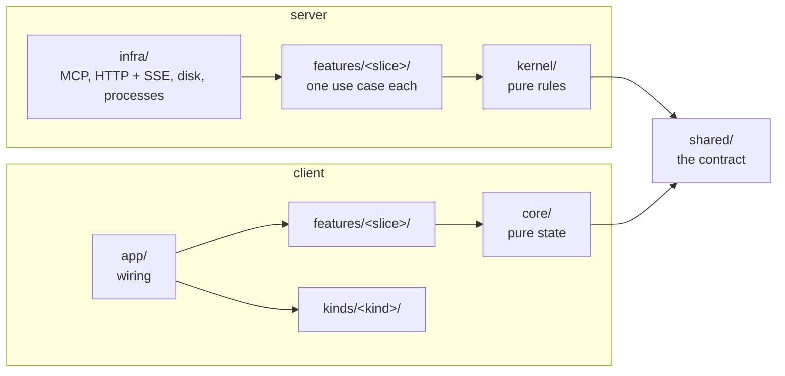

# Workbench conventions

How workbench is built, and the rules a change to it follows. What a machine can
check, `pnpm run check` checks; the rest is for whoever writes and reviews the change.
How tests are written is in [`testing.md`](testing.md).

## Principles

- **Anything critical is enforced by the server, never by instructions alone.** Approve
  is refused while questions are open; a verdict counts only against the revision on
  screen; a run can't close until every item has an outcome; the Stop hook blocks a turn
  that ends with nobody listening. A skill's instructions can be misread; the server can't.
- **The page only shows what the tools put in the run, and only sends the user's
  events.** It creates no content of its own.
- **Nothing the user does is lost.** Every page event is written to the run's log before
  it is applied, and handed to Claude exactly once.
- **One fixed format: the hello proof.** The page proves the server holds the run's token
  with `HMAC(token, "workbench-hello|<nonce>|<port>|<build>")`. Old pages must be able to
  verify new servers, so this string never changes.

## Architecture: vertical slices over a pure kernel

| Folder                     | Holds                                                      | May import               |
| -------------------------- | ---------------------------------------------------------- | ------------------------ |
| `shared/`                  | the contract both halves use: schemas, types, fixed values | nothing of ours          |
| `server/kernel/`           | the rules every item kind obeys, as pure functions         | `shared/`                |
| `server/features/<slice>/` | one use case per folder, with its tests                    | `kernel/`, `shared/`     |
| `server/infra/`            | disk, HTTP, MCP, processes; wires the slices               | anything on the server   |
| `client/core/`             | the page's state, what is derived from it, and its ports   | `shared/`                |
| `client/infra/`            | what implements the ports: the server, drafts, images      | `core/`, `shared/`       |
| `client/features/<slice>/` | one part of the page each                                  | `core/`, `ui/`, `infra/` |
| `client/kinds/<kind>/`     | the view for one item kind                                 | `core/`, `ui/`           |
| `client/app/`              | wires the page together                                    | anything on the client   |

A new feature is a new folder that touches nothing else. The rules above are enforced by
`config/dependency-cruiser.cjs` in `pnpm run check`, so they hold without anyone
remembering them.

**Why dependency-cruiser.** The layering is the one thing a framework would give us, and
for about seventy modules a framework (NestJS, Nx) would be far more machinery than the
rules it brings. The alternatives:

- TypeScript project references can keep layers apart, but they need one `tsconfig` per
  slice to say "slices don't import each other".
- `eslint-plugin-boundaries` would show violations in the editor. It would take every rule
  rewritten in its terms, and it doesn't find cycles.

dependency-cruiser states each rule as data, with its reason. It also finds cycles,
resolves the path aliases through `tsconfig.json`, and fails the check if it read too few
modules to mean anything. Revisit this if the editor feedback starts to matter more than
one tool fewer.

### Adding to it

- **A tool:** a slice in `server/features/<name>/` with its use case and tests, registered
  in `server/infra/mcp/tools.ts`.
- **A kind of item** (pr-review findings, review-queue pull requests): its schema in
  `shared/contract.ts` added to `ItemKinds`, its view in `client/kinds/<kind>/` added to
  `client/kinds/index.ts`. The tools stay the same.
- **A part of the page:** a slice in `client/features/<name>/`, wired in `client/app/`.
- **Something the page needs from outside** (storage, the network): an interface in
  `client/core/ports.ts`, and a class in `client/infra/` that `implements` it, so the
  contract is checked by the compiler and tests can stand in their own.

## Code style

Formatting is Prettier's (settings under `"prettier"` in `package.json`, 120 columns):
run `pnpm run format`. ESLint (`config/eslint.config.mjs`) enforces what a machine can
see, marked _(lint)_ below. Both run in `pnpm run check`. The rest is for review.

### Reading order

- **Code should explain itself.** A name that says what a thing is beats a comment that
  explains a short one. Comments say _why_, never _what_, and only where the code can't
  say it. Every file opens with one line on what it is for.
- **A file reads top-down by importance.** What it exports and exists for comes first;
  the helpers it uses come below, in the order they are needed. A constant sits just
  above the code that uses it.
- **A condition that needs a moment to read gets a name**:
  `const verdictJustLanded = previous !== status;` then `if (verdictJustLanded)`.

### Names and values

- **No single-letter names** _(lint)_. `_` marks a parameter that is deliberately unused.
  Names come from the domain: `item`, `verdict`, `itemIndex`, never `cur` or `x`.
- **No shadowing** _(lint)_: an inner name never hides an outer one.
- **Fixed sets of values are constants, never bare strings.** Compare against
  `VERDICT.approved`, `RUN_STATUS.open`, `CONNECTION.live`, and derive the type from the
  constant. They live with what they describe:
  - `shared/values.ts` for the run's own values (it imports nothing, so the page can use it
    without loading zod);
  - `client/core/connection.ts` for connection kinds, `client/core/state.ts` for actions;
  - `client/core/selectors.ts` for turn views;
  - `client/ui/classes.ts` for CSS classes.
- **A constant other code needs is exported from where it is defined, once.** The
  stream's event names (`STREAM_EVENT` in `shared/constants.ts`) are used by the server
  and the page; the favicon colours (`TURN_COLOR`) by the page and the browser tests.
- **Numbers that mean something get a name** that says why they are that value:
  `ACTIVE_FOR_MS`, `FIRST_ITEM`, `ADVANCE_MS`. In tests, derive them from the product's
  constant when there is one (`PAST_ACTIVE_WINDOW_MS = ACTIVE_FOR_MS + 1_000`).
- **CSS classes are built with `classes()`**, not template strings:
  `classes('iconbtn', open && CLASS.on)`.
- **An object type with two or more fields gets a name**: a component's props are
  `interface <Component>Props`, a function's options are an interface too. Each field on
  its line, with a comment where its meaning isn't obvious.

### Control flow

- **A guard clause's body goes on its own line** _(lint: `curly`)_:
  `if (!item) {` / `return;` / `}`, never `if (!item) return;`.
- **A `switch` over a fixed set of values, not a chain of `if`s**, building the result
  and returning once at the end. One exit makes a function predictable; early returns
  stay for guard clauses at the top.
- **A ternary is for a short either-or** _(lint: no nested ternaries)_. Anything longer
  is an `if`/`else`, a lookup table, or a small function.
- **No inline casts** _(lint: no `x as T`; `as const` stays)_. Types come from:
  - declarations where data enters: `const event: RecordedEvent = JSON.parse(line);`
  - type guards: `error instanceof Error`, `isErrno(error, 'ENOENT')`, `isRecord(value)`;
  - parsers for what can't be trusted: zod for tool results in tests;
  - better-typed APIs: `event.currentTarget` in a handler, a const tuple for a zod enum.
- **A method passed as a callback is bound** _(lint: `unbound-method`)_:
  `load={() => server.liveRuns()}`, never `load={server.liveRuns}`, which loses `this`.
- **Errors are classes in their own file** (`server/kernel/errors.ts`,
  `client/infra/errors.ts`), so callers can tell them apart with `instanceof`.
- **Components render; behaviour lives elsewhere.** Hooks in `client/app/hooks.ts` hold
  stateful behaviour (sending, navigation); pure functions in `client/core/selectors.ts`
  derive what to show. A component reads them and draws.
- **Imports use the path aliases** `@shared/`, `@server/`, `@client/` and `@test/`
  (defined once, in `tsconfig.json`). `./` is only for a file in the same folder; never `../`.
- **Messages the user reads are written once**, as named constants next to where they
  are shown (`SENT` in `client/app/App.tsx`).

## Security

- The run's token lives in `run.json`, in a folder only its user can read. No tool ever
  returns it. The page receives it in the address fragment (never sent to a server) and
  sends it only in a header, and only after the server proved it holds it.
- A server serves only runs it opened. It checks `Host` and `Origin` on every request and
  sends a strict Content-Security-Policy.
- Markdown from Claude is rendered with raw HTML shown as text, then sanitized with
  DOMPurify. Diagrams enter only through `create_diagram`, which writes and escapes the
  Mermaid itself.
- Run data lives in the plugin's data folder (`$CLAUDE_PLUGIN_DATA/workbench`), never
  inside a repository.
- **Accepted risks:**
  - If another program takes over a page's port and the user reloads the old address,
    that program can read the token from the fragment. The page still refuses to talk
    to it.
  - "Open reviews" receives the addresses (tokens included) of the other runs open on the
    machine: same user, same machine, by design.

## Build and dependencies

- **pnpm only** (`packageManager` in `package.json`); `check` refuses an npm lockfile.
  Every version is pinned exactly, install scripts are off (`.npmrc`), and `check` runs
  `pnpm audit`.
- **`dist/` is committed.** It's unusual for a library, but it's what a plugin needs:
  - Claude Code installs the plugin as a plain copy of the repository and starts the
    server from `.mcp.json` when the session opens, before any skill runs. A skill's
    preflight step would come too late: the server would already have failed to start.
  - Building on each machine would mean every developer installs the development
    toolchain (TypeScript, esbuild, Mermaid, Playwright).
  - The bundle has no runtime dependencies; only Node is needed.
  - `pnpm run check` rebuilds `dist/` from the lockfile and fails if it differs from what
    is committed, so a reviewer can trust that `dist/` is exactly the source.
- **A size budget**: the page's first load stays under 150 KB of script, and Mermaid loads
  only when a diagram is shown.

## Checks, hooks and platforms

- `pnpm run check` is the single definition of every check: dependency rules, types,
  format, lint, tests, audit, a reproducible bundle, and the size budget.
- The first `pnpm run build`, `test` or `check` points git at `.githooks/pre-push`, which
  runs `check` before any push that touches `servers/workbench/`. There is no CI yet, so
  this hook is the gate; `git push --no-verify` skips it.
- **Every script is Node, never shell**, so it runs the same on macOS, Linux and Windows.
  The hook itself is one line of `sh` that hands over to `scripts/pre-push.mjs`; Git runs
  hooks with `sh` on every OS (Git for Windows bundles one). Paths go through `node:path`.
  Where the OS differs (opening a browser, reading a process's start time), the code says
  so and has a fallback.
